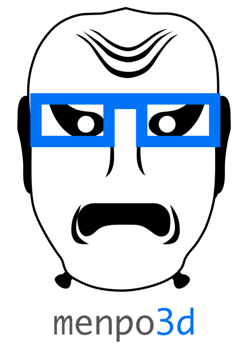

---
jupytext:
  text_representation:
    format_name: myst
kernelspec:
  display_name: Python 3
  language: python
  name: python3
---


<div style="display: flex; align-items: center; flex-direction: column;">
  
  </br>
  <div style="display: flex; align-items: center; justify-content: center; margin-top: 4px; margin-bottom: 20px">
    <a href="https://github.com/menpo/menpo3d" style="display: flex;">
      
    </a>
    <a style="text-decoration: none; color: grey; margin: 5px 25px;" href="https://github.com/menpo/menpo3d">
      <button class="download_button">View on Github</button>
    </a>
    <a href="https://github.com/menpo/menpo3d/blob/master/LICENSE.txt" style="display: flex;">
      
    </a>
  </div>
</div>

# menpo3d

`menpo3d` makes manipulating 3D mesh data a simple task. In particular, this package provides the ability to import, visualize and rasterize 3D meshes. Although 3D meshes can be created within the main [`menpo`](../menpo/index.md) package, this package adds the real functionality for working with 3D data.

menpo3d is pure Python and needs no VTK. Install it with `pip install menpo3d` (see [Installation](../installation/index.md) for the
optional viewers and the extras table). This page describes menpo3d {{ menpo3d_version }}.

## Importing meshes

Meshes are imported with `menpo3d.io`. A few small assets ship with the package:

```{code-cell} ipython3
import menpo3d.io as m3io

m3io.ls_builtin_assets()
```

```{code-cell} ipython3
mesh = m3io.import_builtin_asset("james.obj")
mesh
```

Use `import_mesh` and `import_meshes` for your own `.obj`, `.ply`, `.off`, `.stl` and `.wrl` files. The result is a `TriMesh`
(or a `TexturedTriMesh` / `ColouredTriMesh`) that behaves like any other `menpo` shape.

### One point per face corner

Some OBJ files store a separate vertex for every face corner. Importing such a file gives a mesh with many more points than the
file has vertices, and menpo3d warns about it. `menpo3d.mesh.merge_duplicate_points` merges points with the same position:

```{code-cell} ipython3
from menpo3d.mesh import merge_duplicate_points

print(merge_duplicate_points.__doc__.strip().splitlines()[0])
```

## Visualizing 3D objects

menpo3d draws 3D objects with a [moderngl](https://moderngl.readthedocs.io) renderer. There is no Qt, Mayavi or `%matplotlib` magic involved.
With the `viz_notebook` extra installed, `mesh.view()` is an interactive widget in a Jupyter notebook (drag to rotate, shift-drag to pan, wheel to zoom).
The same call works in a native window or a browser window (also over SSH), and offline into an image, which is what this page does:

```{code-cell} ipython3
import tempfile
from pathlib import Path

from IPython.display import Image

renderer = mesh.view()
path = Path(tempfile.mkdtemp()) / "james.png"
renderer.save_figure(path)
Image(filename=str(path), width=400)
```

`renderer.figure.get_pose()` returns the camera as you left it with the mouse, so that a view can be reproduced.

## Registering one mesh onto another

`menpo3d.correspond.non_rigid_icp` (NICP) deforms a source mesh onto a target while keeping it smooth:

```{code-cell} ipython3
from menpo3d.correspond import non_rigid_icp
import inspect

str(inspect.signature(non_rigid_icp))
```

If the solve is badly conditioned (a warning about the linear system, or a result with spikes), pass a small positive `damping`, which adds
a ridge term to the system. The default `0.0` is the plain solve.

## Rasterizing and unwrapping

`menpo3d.rasterize` renders a mesh to a `menpo` image, `menpo3d.unwrap` flattens a mesh to 2D (for example cylindrical unwrapping of a head),
and `menpo3d.barycentric` converts between barycentric and Cartesian coordinates. See the
[API documentation](https://menpo3d.readthedocs.io/en/stable/) for the full list.
