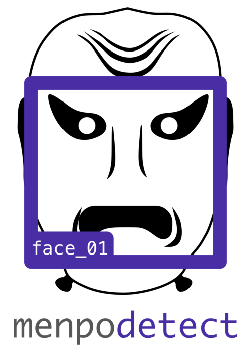

---
jupytext:
  text_representation:
    format_name: myst
kernelspec:
  display_name: Python 3
  language: python
  name: python3
---


<div style="display: flex; align-items: center; flex-direction: column;">
  
  </br>
  <div style="display: flex; align-items: center; justify-content: center; margin-top: 4px; margin-bottom: 20px">
    <a href="https://github.com/menpo/menpodetect" style="display: flex;">
      
    </a>
    <a style="text-decoration: none; color: grey; margin: 5px 25px;" href="https://github.com/menpo/menpodetect">
      <button class="download_button">View on Github</button>
    </a>
    <a href="https://github.com/menpo/menpodetect/blob/master/LICENSE.txt" style="display: flex;">
      
    </a>
  </div>
</div>

# menpodetect

Object detection within the Menpo Project. `menpodetect` does not implement new techniques: it wraps existing detectors so that they take a `menpo`
image and return `menpo` bounding boxes, which is what the fitters of [`menpofit`](../menpofit/index.md) start from. This page describes menpodetect {{ menpodetect_version }}.

Each wrapped library is an optional dependency, installed with an extra (see [Installation](../installation/index.md)):

  - **[OpenCV](http://opencv.org/) (BSD), `pip install "menpodetect[opencv]"`**  
    Haar cascade frontal face, profile face and eye detectors, and arbitrary OpenCV cascade files (by loading them from disk).
  - **[dlib](http://dlib.net/) (Boost Software License), `pip install "menpodetect[dlib]"`**  
    The frontal face detector, arbitrary dlib detector models, and training of your own (`train_dlib_detector`).

`menpodetect` used to wrap two more libraries, pico (academic use only) and ffld2 (GNU AGPL). They were removed. Check the licence of each detector you use: they are not all the same as `menpo`'s.

## Detecting faces

A detector is a callable: it takes an image and returns a list of bounding boxes, and it also attaches each detection to the image as a landmark group.

```{code-cell} ipython3
:tags: [remove-input]

from menpo_docs_data import faces

image = faces(n_train=1, n_test=1)[1][0]
```

```{code-cell} ipython3
from menpodetect import load_opencv_frontal_face_detector

detect = load_opencv_frontal_face_detector()
bounding_boxes = detect(image)

print("{} detected faces".format(len(bounding_boxes)))
print(image.landmarks.group_labels)
```

```{code-cell} ipython3
image.view_landmarks(group='opencv_0', line_colour='red', render_markers=False, line_width=4);
```

With dlib the call is the same:

```python
from menpodetect import load_dlib_frontal_face_detector

detect = load_dlib_frontal_face_detector()
bounding_boxes = detect(image)
```

The group name is the `group_prefix` argument (default `'object'`, here named after the detector) and a number per detection. Large images are slow to search:
`image_diagonal` rescales the image for the detection and returns the boxes in the original image.

## Fitting from a detection

The boxes are `PointDirectedGraph`s of four points, exactly what `fit_from_bb` of the [menpofit fitters](../menpofit/fitting.md) takes:

```python
result = fitter.fit_from_bb(image, bounding_boxes[0])
```

The [AAM](../menpofit/aam.md) page has a complete example.

```{toctree}
:titlesonly:
:hidden:

API Documentation <https://menpodetect.readthedocs.io/>
```
